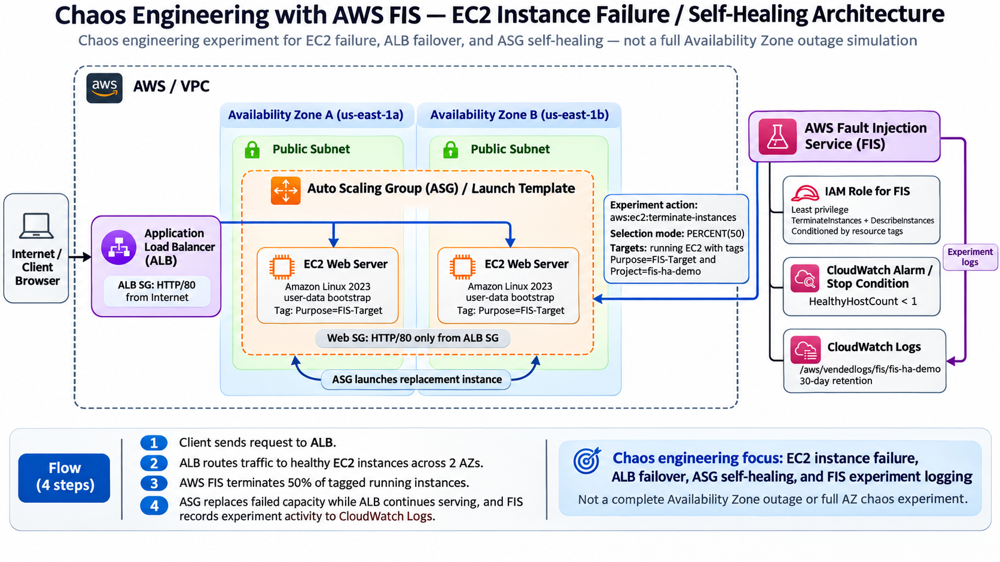
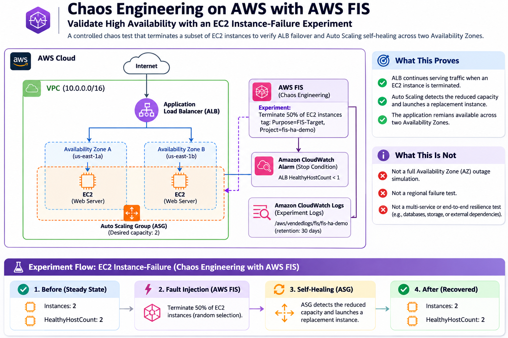

# Chaos Engineering with AWS FIS — EC2 Instance Failure & Self-Healing

A small, resilient two-AZ web tier on AWS, plus an AWS Fault Injection Service (FIS) experiment
that terminates part of the EC2 fleet to test ALB failover behavior and Auto Scaling self-healing.

> **Scope:** this is an EC2 instance-failure experiment, not a full Availability Zone outage simulation.
> It does not inject subnet, zonal control-plane, or other AZ-wide failures.

## Architecture

The primary architecture view shows the runtime path, FIS fault injection, IAM execution role, CloudWatch stop condition, CloudWatch experiment logging, and Auto Scaling recovery behavior across two Availability Zones.



### Logical / Lucid-style view

This second view emphasizes the experiment flow and the boundary between what the test proves and what it intentionally does not simulate. It is a Lucidchart-inspired visual, not an exported Lucidchart file.



```
internet --80--> ALB (2 public subnets, 2 AZs) --80--> Auto Scaling group (min 1, desired 2, max 4)
                                                        t3.micro, Amazon Linux 2023, nginx page from user-data.sh
                                                        every instance tagged Purpose = FIS-Target + Project = fis-ha-demo

FIS experiment: randomly terminate 50% of running instances that match BOTH:
  Purpose = FIS-Target
  Project = fis-ha-demo

FIS experiment events --> CloudWatch Logs (/aws/vendedlogs/fis/fis-ha-demo, 30-day retention)
```

## Files

- `versions.tf`: Terraform and provider versions, provider configuration.
- `variables.tf`: every input, with defaults that match the design above.
- `main.tf`: shared data sources and locals (two AZs, resolved AMI, the FIS tag defined once).
- `network.tf`: VPC, two public subnets, Internet Gateway, public route table.
- `alb.tf`: ALB security group, ALB, target group with health checks, port 80 listener.
- `compute.tf`: instance security group, launch template (applies the FIS tag), Auto Scaling group.
- `fis.tf`: FIS IAM role and policy, CloudWatch experiment log group, stop-condition alarm, experiment template.
- `outputs.tf`: the URL, IDs, and the command that starts the experiment.
- `user-data.sh`: the "Opening soon" page for GabrielBoyowaOfficial (nginx on Amazon Linux 2023); it identifies this as a two-AZ demo.
- `preview.html`: local two-server/two-AZ preview of the page without deploying AWS resources.
- `docs/images/`: repo-ready architecture diagrams for the README, including the detailed AWS view and a Lucidchart-inspired logical view.

## Before you run it

- **Windows:** copy this folder to a short path first, for example `C:\dev\fis-ha-demo`. Terraform
  unpacks the AWS provider (about 800 MB) under `.terraform\providers\...`, and under a long folder
  path that goes past Windows' 260-character limit, so `init` or `plan` can fail.
- **Credentials:** the AWS CLI must be signed in to the account you want to use. Check with
  `aws sts get-caller-identity`. Run Terraform as an IAM user, role or SSO session, not the root user.
- **user-data.sh:** change `SITE_NAME` and `CONTACT_EMAIL` at the top if you like. Keep LF line
  endings and stay under 16 KB: Terraform refuses to continue if either is wrong.
- **Region:** `us-east-1` by default. Change it with `-var aws_region=eu-west-1` or a `terraform.tfvars` file.
- **AMI behavior:** by default Terraform resolves the current Amazon Linux 2023 x86_64 AMI from AWS's public SSM parameter. For reproducible runs, pin a compatible Amazon Linux 2023 image with `-var 'ami_id=ami-0123456789abcdef0'`. Changing the resolved/pinned AMI creates a new launch-template version and the ASG performs its rolling instance refresh.
- **FIS logs:** Terraform creates `/aws/vendedlogs/fis/<project_name>` with 30-day retention and enables FIS experiment logging (schema version 2). When AWS configures a new CloudWatch Logs delivery destination for the first time, the identity establishing that delivery may need `logs:CreateLogDelivery`, `logs:PutResourcePolicy`, `logs:DescribeResourcePolicies`, and `logs:DescribeLogGroups`.

## Deploy

These commands are for Git Bash (they use `$(...)`); they will not run as-is in PowerShell.

```bash
cd /c/dev/fis-ha-demo
terraform init
terraform apply
```

`apply` waits until both servers are healthy behind the ALB (a few minutes), so a broken
user-data script fails the apply instead of passing silently. When it finishes, open the
`alb_url` output in a browser.

## Run the FIS experiment

Console: **Fault Injection Service**, then **Experiment templates**, open the one whose
description starts **"Instance-failure HA test"**. Review the resolved targets before starting a
destructive run. This experiment terminates EC2 instances; it does not simulate a full AZ outage.

CLI, in two terminals. First terminal, watch the site once a second and leave it running:

```bash
URL=$(terraform output -raw alb_url)
while true; do
  out=$(curl -s -o /dev/null -D - --max-time 3 "$URL" | tr -d '\r' | awk 'NR==1{c=$2} tolower($1)=="x-served-by:"{s=$2" "$3} END{if (c) print c, s}')
  echo "$(date +%T) ${out:-no response}"
  sleep 1
done
```

Second terminal, **preview the targets first without injecting a fault**:

```bash
PREVIEW_ID=$(aws fis start-experiment \
  --experiment-template-id "$(terraform output -raw fis_experiment_template_id)" \
  --experiment-options actionsMode=skip-all \
  --region "$(terraform output -raw aws_region)" \
  --query 'experiment.id' --output text)

aws fis list-experiment-resolved-targets \
  --experiment-id "$PREVIEW_ID" \
  --region "$(terraform output -raw aws_region)" \
  --output table
```

If target resolution is still finishing, rerun the `list-experiment-resolved-targets` command after
a few seconds. Confirm the preview contains only the expected `fis-ha-demo` web instances. A preview resolves
targets but skips all fault actions; the actual run can still resolve a different random member of
the same eligible set.

Then start the destructive experiment:

```bash
aws fis start-experiment \
  --experiment-template-id "$(terraform output -raw fis_experiment_template_id)" \
  --region "$(terraform output -raw aws_region)" \
  --query 'experiment.[id,state.status]' --output text
```

Follow it (replace `EXP_ID` with the ID printed above):

```bash
aws fis get-experiment --id EXP_ID --region "$(terraform output -raw aws_region)" --query 'experiment.state'

aws elbv2 describe-target-health --region "$(terraform output -raw aws_region)" \
  --target-group-arn "$(terraform output -raw target_group_arn)" \
  --query 'TargetHealthDescriptions[].[Target.Id,TargetHealth.State]' --output table

aws autoscaling describe-scaling-activities --region "$(terraform output -raw aws_region)" \
  --auto-scaling-group-name "$(terraform output -raw asg_name)" --max-items 5 \
  --query 'Activities[].[StartTime,StatusCode,Description]' --output table
```

In another terminal, you can also follow the detailed FIS experiment events as they arrive:

```bash
aws logs tail "$(terraform output -raw fis_log_group_name)" \
  --follow \
  --region "$(terraform output -raw aws_region)"
```

FIS writes events such as target resolution, action start/end, and experiment state changes to this log group.

## What you should see

1. Shortly after the experiment starts, FIS randomly terminates one of the two eligible instances.
2. The watch loop keeps printing `200` from the surviving instance. Requests that land on the
   terminated one can fail briefly (`502` or `504`, or `no response`) until the ALB's health check
   removes it, roughly 20 seconds with the settings in `alb.tf`.
3. The Auto Scaling group notices and launches a replacement. It needs time to boot, install
   nginx and pass two health checks, so expect a couple of minutes before there are two servers again.
4. Refresh the page: the footer names the instance and zone that answered, and the line colour
   changes with the zone.

## Troubleshooting

- **`apply` times out waiting for healthy instances.** The user-data script failed. In the EC2
  console, open an instance and use **Actions**, **Monitor and troubleshoot**, **Get system log**.
- **The experiment fails at once with no targets.** Fewer than two instances were running.
  `PERCENT(50)` rounds down and FIS cannot select less than one instance, so with a single
  instance it refuses to run rather than take down the last server. Wait for both to be healthy.
- **Access denied the first time you start an experiment.** FIS creates a service-linked role
  (`AWSServiceRoleForFIS`) on first use, which needs `iam:CreateServiceLinkedRole` (administrators have it).

## Clean up

```bash
terraform destroy
```

Left running, the ALB and two t3.micro instances cost roughly a dollar a day at us-east-1
on-demand prices (check current pricing). FIS charges per action-minute and one instant
termination is negligible.

## Design notes

- **No NAT gateway, as specified.** The instances are in public subnets with public IPs so they can
  reach the package repositories, but their security group accepts HTTP only from the ALB's
  security group. There is no SSH rule. They require IMDSv2 and use encrypted volumes.
- **Two target boundaries.** `Purpose = FIS-Target` marks instances as intentionally eligible for
  fault injection, while `Project = fis-ha-demo` confines this experiment to this deployment. Both
  tags must match in FIS target resolution and in the IAM permission that allows termination.
- **FIS role.** The trust policy lets only the FIS service assume it, only for experiments from this
  account and Region. Its read permission is limited to `ec2:DescribeInstances`; termination is
  allowed only when both the FIS eligibility tag and the project tag match.
- **Experiment target.** Matches both tags, only running instances (a terminated instance keeps its
  tags and stays visible for a while), and only inside this VPC. Use the target-preview command
  before destructive runs.
- **Stop condition.** A CloudWatch alarm on the ALB's healthy host count. EC2 termination is
  irreversible once requested, so this guardrail mainly protects any additional duration-based or
  follow-up actions you add later.
- **Experiment logging.** FIS sends detailed experiment events to `/aws/vendedlogs/fis/<project_name>`
  with a 30-day retention period. This is separate from the CloudWatch metric alarm used as the
  stop condition: the alarm is a safety guardrail, while the log group is the experiment audit trail.
  The FIS experiment role remains scoped to the EC2 fault action; AWS service log delivery writes
  the experiment events to CloudWatch Logs.

## What this experiment does not test

This project does **not** claim to simulate loss of an entire Availability Zone. The injected fault
is EC2 instance termination. The two-AZ layout provides a surviving instance in another zone for
the test, but subnet impairment, AZ-wide networking loss, and zonal service/control-plane failures
are outside this experiment's scope.

## Next steps

HTTPS on the ALB with an ACM certificate, a target-tracking scaling policy so the maximum of 4
is used, SSM Session Manager access instead of SSH, ALB access logs, remote state, private
subnets with a NAT gateway, and optional FIS experiment reports for richer post-experiment evidence.
